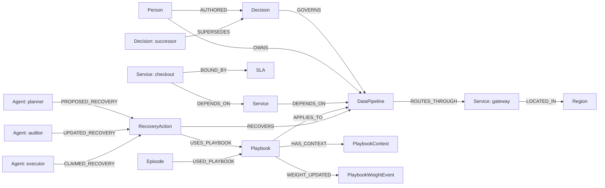

# Aegis-0 — graph-checked incident recovery

**[Watch the working demo on YouTube](https://youtu.be/2Gdl9QzXtrk)**

A payment route is slow, but the fastest backup violates the current company
policy. Aegis uses FalkorDB to find a permitted recovery, audit it in an ephemeral
shadow graph, execute it against local HTTP services, and measure the result
before recording success.

**WeMakeDevs × FalkorDB Graph Hacks:** Track 01: Agents That Act on Connected
Data (primary), Track 02: Agent Memory and Coordination, and Track 03: Company Brain.

## What the demo proves

1. The US failover is rejected by the active EU-only policy.
2. The permitted EU route is approved and executed. The recorded run's measured
   HTTP p95 falls from **416.4 ms to 118.9 ms**.
3. A handoff persists in FalkorDB after approval. A new policy freezes its target;
   the executor returns **STALE** without switching the route.
4. Action records, governing decisions, receipts, and individual request samples
   can be inspected and exported as JSON.

All services and company records are synthetic. HTTP observations are real
loopback requests. The graph's **140 ms predicted dependency-path latency** is
separate from measured router/gateway HTTP latency. Three samples demonstrate
the recovery loop; they do not establish a production percentile SLA.

## Complete local setup

Requirements: **Python 3.10+**, **Docker with Compose**, and Git. Start Docker
before running the commands. FalkorDB binds only to `127.0.0.1:6379`.
No paid service, cloud account, or model API key is required.

### Windows PowerShell

```powershell
git clone https://github.com/umar-test-projects/Aegis-0.git
cd Aegis-0
python -m venv .venv
.\.venv\Scripts\python.exe -m pip install -r requirements.txt
docker compose up -d --wait
.\.venv\Scripts\python.exe aegis_demo.py --reset --seed-only
$env:AEGIS_GRAPH_NAME = 'aegis_demo_verified'
.\.venv\Scripts\python.exe -m streamlit run aegis_dashboard.py
```

### macOS / Linux

```bash
git clone https://github.com/umar-test-projects/Aegis-0.git
cd Aegis-0
python3 -m venv .venv
.venv/bin/python -m pip install -r requirements.txt
docker compose up -d --wait
.venv/bin/python aegis_demo.py --reset --seed-only
export AEGIS_GRAPH_NAME=aegis_demo_verified
.venv/bin/python -m streamlit run aegis_dashboard.py
```

Open **http://localhost:8501**. Click **Start measured services**, then **Run
measured recovery**. Expand the rejected US and verified EU attempts to inspect
their policies, predictions, and observations.

For the stale-handoff scene, click **Reset graph + local incident**, then
**Prepare handoff**. In the sidebar's **Simulate Incoming Slack Thread**, submit:

```text
Freeze all traffic to Zurich DR node due to maintenance.
```

Click **Execute / resume handoff**. The previous approval must become `STALE`.
The Slack-style input is a local simulation; it sends no Slack message.
Resetting explicitly clears the dedicated demo graph's history.

For a complete headless run on Windows:

```powershell
.\.venv\Scripts\python.exe aegis_demo.py --reset --output scratch/recovery.json
```

On macOS/Linux, use `.venv/bin/python aegis_demo.py --reset --output scratch/recovery.json`.

The CLI uses `aegis_demo_verified` and saves runtime receipts in
`scratch/demo-runtime.json`. Reset guards refuse production graph names.
For an existing database, configure `FALKORDB_HOST`, `FALKORDB_PORT`, and optionally
`FALKORDB_PASSWORD`. Stop the Compose database with `docker compose down`.
Keep the container running to retain graph memory; this Compose setup has no
named data volume and does not promise persistence after container removal.

## Graph data model



`RecoveryAction` stores status, version, the audited input snapshot, runtime
identity/revision, and before/after observations. `RecoveryLease`, keyed by
pipeline ID, serializes competing actions. The schema is also exposed as the MCP
resource `falkordb://aegis/schema` in [aegis_company_brain.py](aegis_company_brain.py).

## Cypher and algorithms

See [the actual read queries extracted from the source](docs/graph-queries.cypher).
Run each query separately, supplying the parameters in its comments.

| Product behavior | Implementation |
| --- | --- |
| Active policy, ownership, and playbook recall | [aegis_falkordb_engine.py](aegis_falkordb_engine.py), `recall_playbooks_and_company_brain` |
| Bounded dependency traversal and shadow audit | Same file, `run_shadow_graph_simulation` |
| Freshness check and graph commit in one Cypher query | Same file, `coordinate_handoff_and_commit` |
| Durable phases, action versions, and pipeline lease | [aegis_recovery.py](aegis_recovery.py) |
| Read-only Company Brain intent queries | [aegis_company_brain.py](aegis_company_brain.py) |

Active decisions exclude incoming `SUPERSEDES` relationships. Shadow audits
traverse `DEPENDS_ON` paths up to four hops and check every attached SLA,
regional/traffic policy, capacity limit, and lock wait. Every shadow graph is
deleted in a `finally` block; its captured evidence remains available.

Service criticality uses an equal-weight mean of normalized incoming degree and
directed Brandes betweenness on service-to-service dependency edges. It is a
structural risk ranking, not an outage probability. Policy-scoped playbook
weights change after rejected attempts or committed success; simulation approval
alone earns no reward. These weights guide ranking rather than calibrated
success probabilities.

## MCP agent and independent executor

The executable agent is a bounded MCP client. Planner, auditor, and executor are
independently callable phases sharing graph state, rather than three reasoning
LLMs. The dashboard invokes this client through a real MCP server process.

In PowerShell, start a persistent local runtime:

```powershell
$env:AEGIS_GRAPH_NAME = 'aegis_demo_verified'
$env:AEGIS_RUNTIME_URL = 'http://127.0.0.1:8787'
$env:AEGIS_RUNTIME_TOKEN = [guid]::NewGuid().ToString('N')
.\.venv\Scripts\python.exe aegis_runtime.py --port 8787
```

In a second terminal, set the **same values** for those three environment
variables, then run:

```powershell
.\.venv\Scripts\python.exe aegis_agent.py --stop-after-approval
.\.venv\Scripts\python.exe aegis_agent.py --resume ACTION_ID
```

Replace `ACTION_ID` with the returned `action_id`. On macOS/Linux, use `export`
for the variables, generate a shared token with `.venv/bin/python -c
"import secrets; print(secrets.token_hex(32))"`, and use `.venv/bin/python`.
Each agent command starts a new MCP server process. Omitting
`--stop-after-approval` completes the workflow in one run.

Tools include `observe_local_runtime`, `recall_procedural_playbooks`,
`propose_local_recovery`, `audit_local_recovery`, `execute_local_recovery`, and
`get_local_recovery`. The runtime accepts authenticated control at literal
loopback HTTP origins; agent input cannot select an arbitrary destination.

## Verification and evaluation

The [recorded evaluation](docs/evaluation-results.md) reports **161 passing tests**
with live integration enabled and **8/8 disclosed synthetic scenarios**. Full
JSON evidence is included in [docs/evidence](docs/evidence).

On macOS/Linux, run the evaluation:

```bash
.venv/bin/python aegis_demo.py --evaluate --output scratch/evaluation.json
```

On Windows, evaluate and enable live tests:

```powershell
.\.venv\Scripts\python.exe aegis_demo.py --evaluate --output scratch/evaluation.json
$env:AEGIS_TEST_FALKORDB = '1'
.\.venv\Scripts\python.exe -m pytest -q
```

On macOS/Linux, enable live tests:

```bash
AEGIS_TEST_FALKORDB=1 .venv/bin/python -m pytest -q
```

Tests and evaluation use unique disposable `aegis_test_*` graphs and clean them
up. Explicitly enabled live tests fail when FalkorDB is unavailable. Without the
flag, integration tests are skipped. The evaluation covers recovery, stale
approval, blocked candidates, gateway failure, interrupted execution, duplicate
execution, policy change during execution, and memory enabled/disabled. The
repeated memory fixture needs one learned attempt versus two baseline attempts;
this is not a general recovery-time benchmark.

## Boundaries

HTTP effects and graph commits are not one distributed transaction. Freshness
is checked before dispatch, after observation, and atomically at graph commit.
A policy change during execution may briefly leave a route applied; detection
disables the local router and records `STALE`. Failed verification also disables
the router. Unavailable-runtime compensation is recorded as incomplete.
Versioned `FINALIZING`/`STOPPING` phases fence concurrent success and compensation;
restarts use the same action ID, persisted runtime identity, and receipts.

The original shadow-triage/reporting tools are graph-only, model-based features.
Their projected outcomes are separate from the measured HTTP recovery workflow.
[Advanced dashboard usage](docs/advanced-usage.md) documents these optional tools.

## Submission and disclosure

- **Public code:** [umar-test-projects/Aegis-0](https://github.com/umar-test-projects/Aegis-0)
- **Demo video:** [Watch Aegis-0](https://youtu.be/2Gdl9QzXtrk)
- **Setup and graph model:** this README; complete local setup is provided in
  place of a public deployment.
- **Queries and evidence:** [Cypher](docs/graph-queries.cypher),
  [evaluation](docs/evaluation-results.md), and [JSON evidence](docs/evidence).

**AI assistance:** OpenAI Codex assisted with implementation, tests,
documentation, and video production. Narration is an AI-generated neural voice.
All infrastructure, people, policies, and source records in the demo are
synthetic. The project changes only its local simulator, never real production
infrastructure. Participants should be able to explain the code and its limits.
